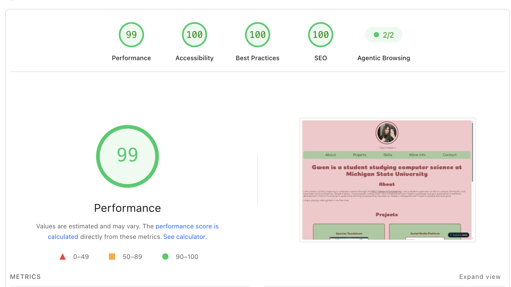

## Accessibility 
With my original color pallette I got a score of 93. My main issue was that the colors I chose for the background and text had too low a contrast so it was hard to read. I ended up fixing this by changing my colors around to be more bold and have much more contrast.

https://pagespeed.web.dev/analysis/https-gwen-haslett-netlify-app/53688hadzl?form_factor=desktop

